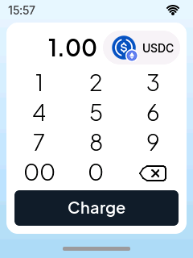
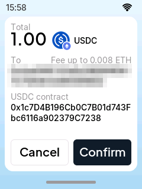
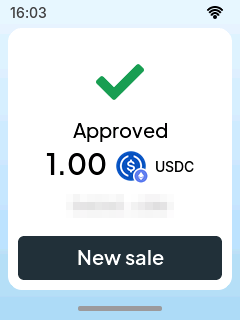

:description: Taking a USDC payment on a Cryptnox POS terminal, step by step with screenshots: the merchant picks the coin and the amount, the customer reviews the recipient and fee, enters the card PIN, taps the Cryptnox card, and the terminal shows Approved once the transaction is mined.
:orphan:

=====================================
Cryptnox POS: take a USDC payment
=====================================

*Last reviewed: 22 October 2026. Screens from firmware v1.0.0 on a test network. Addresses, fees and
amounts differ on your terminal.*

Everything happens on the terminal, but two people use it: the **merchant** sets up the charge,
the **customer** approves and pays with the card. This page is part of the `Cryptnox POS guide
<cryptnox-pos.html>`__.

Before you start
================

The terminal must already be `set up <cryptnox-pos-setup.html>`__ and connected to Wi-Fi. The
customer's Cryptnox Hardware Wallet card needs enough USDC on Ethereum, plus a little ETH to pay the
network fee.

Step 1: choose the coin (merchant)
==================================

The amount screen opens on the coin used last time. Change it if needed.

.. list-table::
   :widths: 33 33 34

   * - .. figure:: _static/cryptnox-pos/payment-01-amount.png
          :alt: Amount screen showing 0.00 USDC, a keypad and a greyed Charge button
          :width: 240px

          Tap the coin button next to the amount.
     - .. figure:: _static/cryptnox-pos/payment-02-network.png
          :alt: Network picker: Ethereum, Polygon, Tron
          :width: 240px

          Pick the network: **Ethereum**.
     - .. figure:: _static/cryptnox-pos/payment-03-coin.png
          :alt: Coin on Ethereum picker: ETH, USDC (ERC-20), USDT (ERC-20)
          :width: 240px

          Pick the coin: **USDC (ERC-20)**.

Step 2: enter the amount (merchant)
===================================

   Type the amount, for example 1.00. The **00** key adds two zeros at once. Tap **Charge**.

Step 3: review the payment (customer)
=====================================

Hand the terminal to the customer.

   The terminal shows the total, the recipient (the merchant's payout address), the maximum network
   fee in ETH, and the USDC contract. Tap **Confirm**, or **Cancel** to stop.

.. important::

   The recipient must be the merchant's own payout address. If it is not, tap **Cancel**.

Step 4: enter the card PIN (customer)
=====================================

.. list-table::
   :widths: 50 50

   * - .. figure:: _static/cryptnox-pos/payment-06-pin.png
          :alt: Enter PIN screen with an empty Card PIN field and a keypad
          :width: 240px

          The terminal asks for the PIN of the Cryptnox Hardware Wallet that will pay.
     - .. figure:: _static/cryptnox-pos/payment-07-pin-entered.png
          :alt: Enter PIN screen with the PIN entered as dots
          :width: 240px

          Type the PIN and tap ✓. The back arrow returns to the previous screen.

Step 5: tap the card (customer)
===============================

.. list-table::
   :widths: 50 50

   * - .. figure:: _static/cryptnox-pos/payment-08-tap-card.png
          :alt: Tap your card screen: Total 1.00 USDC, a contactless symbol and a Cancel button
          :width: 240px

          With the total still on screen, hold the Cryptnox card against the reader. Tap **Cancel**
          to stop the payment.
     - .. figure:: _static/cryptnox-pos/payment-09-signing.png
          :alt: Signing screen with a spinner and the words Checking balance
          :width: 240px

          The terminal checks the card's balance and the card signs the payment. Keep the card on the
          reader and wait for the result.

Step 6: payment approved
========================

Back to the merchant.

   The terminal shows **Approved** with the amount, the coin and a shortened transaction hash. Tap
   **New sale** to take the next payment.

*Approved* appears only once the transaction is mined with a success status and the receipt matches
the amount, the contract and the payout address. How long that takes depends on the chain, not on
the terminal.

Next
====

* `Settings and the control panel <cryptnox-pos-settings.html>`__: switch between production and
  test networks, change fees, update the firmware.
* `First-time setup <cryptnox-pos-setup.html>`__.
* `Cryptnox POS guide <cryptnox-pos.html>`__: parts, wiring, flashing and what the dev kit is not.
