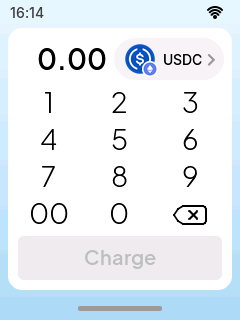
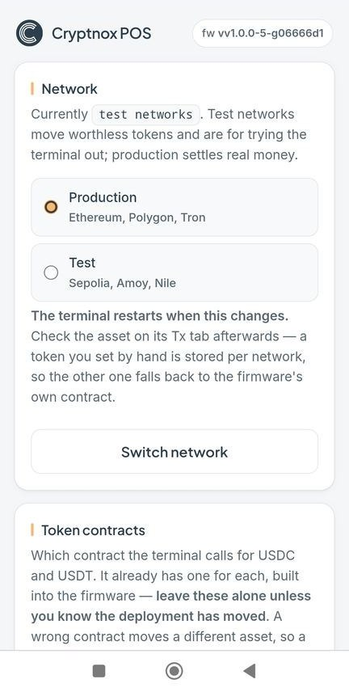
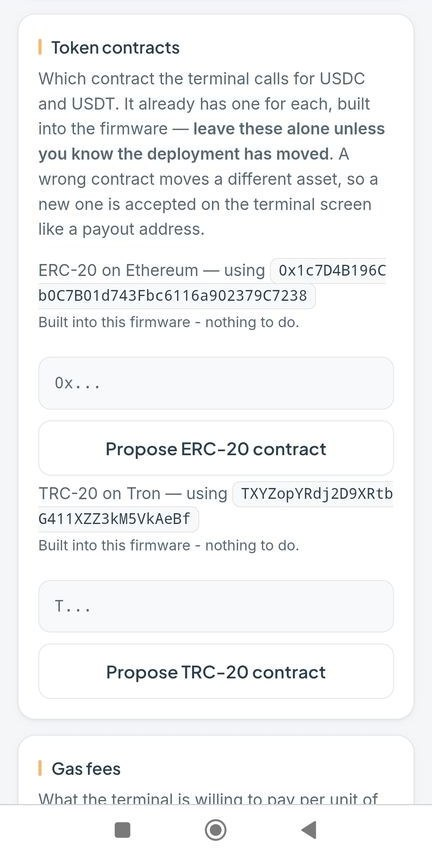
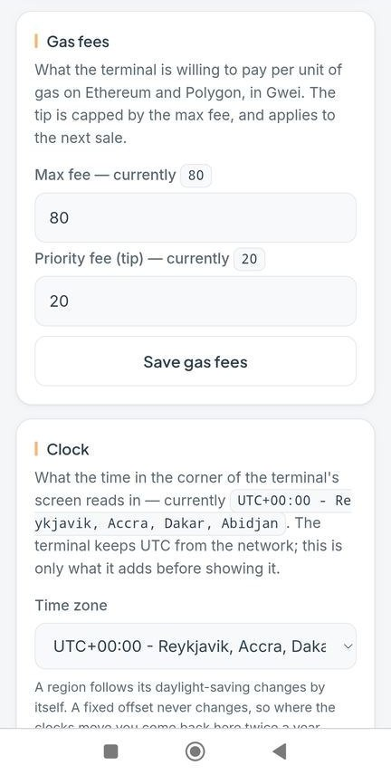
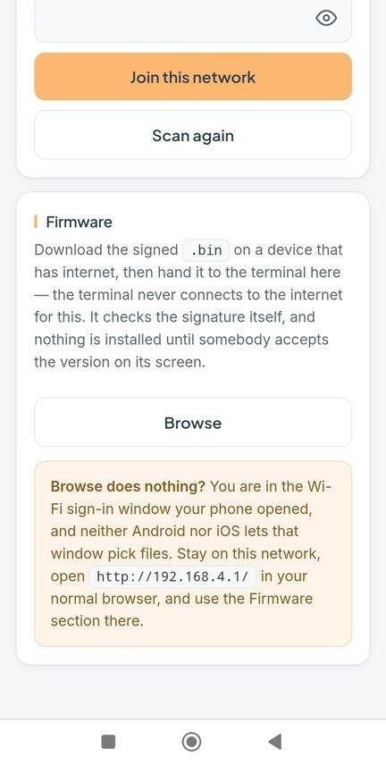

:description: The Cryptnox POS control panel and settings page, with screenshots: opening the panel, the Screen, Wi-Fi, Tx and About tabs, connecting a phone, and the browser settings for networks, token contracts, gas fees, clock, payout addresses, Wi-Fi and firmware updates.
:orphan:

============================================
Cryptnox POS: settings and the control panel
============================================

*Last reviewed: 22 October 2026. Screens from firmware v1.0.0-5-g06666d1. Payout addresses and
Wi-Fi network names in the screenshots are placeholders.*

How to open the terminal's control panel, what each of its four tabs does, and how to change the
settings from your phone. Allow about ten minutes, and keep the admin code to hand. This page is
part of the `Cryptnox POS guide <cryptnox-pos.html>`__.

1. Open the control panel (terminal)
====================================

Start from the sale screen, the one with the keypad and the **Charge** button. Find the small grey
bar at the very bottom edge of the screen, put your finger on it and slide it upwards, towards the
keypad. The admin code screen slides up from the bottom.

   Slide the bottom bar up.

.. note::

   The swipe has to start on the bar itself. A swipe that starts on the keypad does nothing.

2. Enter the admin code (terminal)
==================================

.. list-table::
   :widths: 50 50

   * - .. figure:: _static/cryptnox-pos/settings-02-control-panel.png
          :alt: Control panel screen with an empty Admin code field and a keypad
          :width: 240px

          Empty field.
     - .. figure:: _static/cryptnox-pos/settings-03-code-entered.png
          :alt: Control panel screen with six dots entered in the Admin code field
          :width: 240px

          Code entered; tap ✓.

Type the admin code on the keypad. Each digit appears as a dot. Tap the eye icon to check what you
typed, ⌫ to delete the last digit, ✓ to confirm. The ‹ arrow next to *Control panel* takes you back
to the sale screen without opening anything.

The admin code is the one created when the terminal was first set up. It is only ever typed on the
terminal itself, never on a phone or computer.

3. The four tabs: Screen, Wi-Fi, Tx, About
==========================================

The control panel has four tabs along the top. Tap a tab name to switch. **Close** returns to the
sale screen.

.. list-table::
   :widths: 50 50

   * - .. figure:: _static/cryptnox-pos/settings-04-screen-tab.png
          :alt: Screen tab with a Brightness slider at 80% and a Touch, Calibrate the panel button
          :width: 240px

          **Screen.** The only tab you configure entirely on the terminal. *Brightness*: drag the
          slider. *Touch*: tap **Calibrate the panel** if taps land in the wrong place, then follow
          the targets on screen.
     - .. figure:: _static/cryptnox-pos/settings-05-wifi-tab.png
          :alt: Wi-Fi tab showing network ShopNet and a Configure, Open in a browser button
          :width: 240px

          **Wi-Fi.** *Network*: the Wi-Fi network the terminal is connected to now. *Configure*:
          opens the phone setup page, where you pick another network and type its password.
   * - .. figure:: _static/cryptnox-pos/settings-06-tx-tab.png
          :alt: Tx tab showing USDC on Ethereum Sepolia, the USDC contract and the Send to address
          :width: 240px

          **Tx.** What the terminal charges in and where the money goes. Read-only, scrolls.
          *Asset*: tap the top row to view another asset's details. *Contract*: the token contract
          used for that asset. *Send to*: your payout address; every sale is paid here.
     - .. figure:: _static/cryptnox-pos/settings-07-tx-tab-scrolled.png
          :alt: Tx tab scrolled down showing Max fee 80, Priority fee 20 and a Configure, Fees in a browser button
          :width: 240px

          **Tx, scrolled.** *Max fee* and *Priority fee*: the gas limits for Ethereum and Polygon,
          in Gwei. *Configure*: opens the phone setup page to change any of the above.
   * - .. figure:: _static/cryptnox-pos/settings-08-about-tab.png
          :alt: About tab showing the cryptnox-pos version, an Update, From a browser button, and Reset and Close buttons
          :width: 240px

          **About.** *Version*: the firmware the terminal runs. *Update*: opens the phone setup page
          to install new firmware. *Reset*: erases all settings (Wi-Fi, brightness, fees) and
          restarts; the terminal asks you to confirm first.
     - **Three buttons, one destination.** The buttons in Wi-Fi (*Configure*), Tx (*Configure*)
       and About (*Update*) have different labels but do the same thing: they start the terminal's
       own Wi-Fi so you can finish the job on your phone. Whichever one you tap, you land on the
       same page, with every setting on it.

4. Connect your phone to the terminal
=====================================

After you tap one of the three buttons, the terminal shows a QR code and the name and password of
its own Wi-Fi network, named ``Cryptnox-XXXX``.

1. Open your phone's camera, point it at the QR code and accept the offer to join the network. No
   camera? Join ``Cryptnox-XXXX`` in your phone's Wi-Fi settings and type the password shown on the
   terminal.
2. The phone opens a sign-in window titled *Connect to Cryptnox-XXXX* (address ``192.168.4.1``). If
   it does not, open ``http://192.168.4.1/`` in a browser.
3. The page asks you to authorise this browser. Look at the terminal: it asks for the admin code
   again and shows a four-digit browser number.
4. Check that the number on the terminal matches the one on your phone, then enter the admin code
   on the terminal.

   The setup page on your phone.

.. note::

   While the page is open, the terminal leaves the shop's Wi-Fi and cannot take payments. The page
   closes on its own after 15 minutes. If the numbers do not match, another device is trying to
   connect: do not enter the code, tap **Done** and start again.

5. Configure in the browser (phone)
===================================

The page is one long scroll of sections. Change only what you need; each section has its own save
button. Anything that decides where money goes must then be accepted on the terminal's screen.

Network
-------

.. figure:: _static/cryptnox-pos/settings-10-phone-network.jpg
   :alt: Network section with Production and Test options and a Switch network button
   :width: 240px

Choose between **Production** (Ethereum, Polygon, Tron: real money) and **Test** (Sepolia, Amoy,
Nile: worthless test tokens for trying the terminal out). Select one and tap **Switch network**. The
terminal restarts when the network changes. Check the asset on the Tx tab afterwards.

Token contracts
---------------

The contracts the terminal calls for USDC and USDT, one for ERC-20 (Ethereum) and one for TRC-20
(Tron). The firmware already has the right ones built in. Leave these alone unless you know the
token's deployment has moved: a wrong contract moves a different asset. A new contract must be
accepted on the terminal screen.

Gas fees
--------

The most the terminal will pay per unit of gas on Ethereum and Polygon, in Gwei. *Max fee*: upper
limit per unit of gas. *Priority fee*: the tip to validators, capped by the max fee. Tap **Save gas
fees**. The new values apply from the next sale.

Clock
-----

.. list-table::
   :widths: 50 50

   * - .. figure:: _static/cryptnox-pos/settings-13-phone-clock.jpg
          :alt: Clock section with a Time zone drop-down and a Save clock button
          :width: 240px
     - .. figure:: _static/cryptnox-pos/settings-14-phone-time-zones.jpg
          :alt: Time zone list with UTC+01:00 EU DST Zurich, Geneva, Paris selected
          :width: 240px

Sets the time zone for the clock in the corner of the terminal's screen. Pick your region in the
*Time zone* list and tap **Save clock**. Entries marked *EU DST* follow daylight-saving changes
automatically. A fixed offset never changes, so you would have to come back twice a year.

Payout addresses
----------------

.. list-table::
   :widths: 50 50

   * - .. figure:: _static/cryptnox-pos/settings-15-phone-payout.jpg
          :alt: Payout addresses section showing current Ethereum and Tron addresses, a Cryptnox card and a Read from a Cryptnox card button
          :width: 240px
     - .. figure:: _static/cryptnox-pos/settings-16-phone-type-address.jpg
          :alt: Or type an address, with Ethereum and Tron fields and Propose buttons
          :width: 240px

Where takings are sent. Two ways to set them:

* **Read from a Cryptnox card.** Tap the button, then hold the merchant's card on the terminal and
  enter its PIN there. The card's own addresses become the payout addresses.
* **Type an address.** One Ethereum address (also used for Polygon) and one Tron address, each with
  its own **Propose** button.

Either way, the phone only proposes the address. The terminal shows it on its own screen, and you
must tap **Accept** there. Check it character by character before you do.

Wi-Fi
-----

.. list-table::
   :widths: 50 50

   * - .. figure:: _static/cryptnox-pos/settings-17-phone-wifi.jpg
          :alt: Wi-Fi section with current network ShopNet, SSID and Password fields, Join this network and Scan again buttons
          :width: 240px
     - .. figure:: _static/cryptnox-pos/settings-18-phone-ssid-list.jpg
          :alt: List of nearby Wi-Fi networks with signal strengths in dBm
          :width: 240px

Connects the terminal to the shop's network. Open the SSID list and choose your network; the number
in brackets is signal strength, closer to zero is stronger. Type the network password and tap
**Join this network**. Tap **Scan again** if your network is missing; the page drops for a moment
and comes back. Once the terminal joins the new network, this page disconnects for good.

Firmware
--------

Installs a firmware update. The terminal never downloads it itself.

1. On a device with internet, download the signed ``.bin`` file (the ``-app.bin`` of a `release
   <https://github.com/cryptnox/cryptnox-pos/releases>`__).
2. Tap **Browse** and choose the file.
3. The terminal checks the signature, then shows the new version. Accept it on the terminal to
   install.

.. note::

   **Browse does nothing?** The phone's Wi-Fi sign-in window cannot pick files, on Android or iOS.
   Stay on the ``Cryptnox-XXXX`` network, open ``http://192.168.4.1/`` in your normal browser and
   use the Firmware section there.

6. Close the session (terminal)
===============================

When you are finished, tap **Done** on the terminal. Its own Wi-Fi switches off, it reconnects to
the shop's network, and the page on your phone stops working. Tap **Close** to leave the control
panel and return to the sale screen. Before taking real payments, open the Tx tab once more and
check the payout address. If you forget, the session ends on its own after 15 minutes.

Next
====

* `First-time setup <cryptnox-pos-setup.html>`__.
* `Take a USDC payment <cryptnox-pos-payment.html>`__.
* `Cryptnox POS guide <cryptnox-pos.html>`__: parts, wiring, flashing, the secure build and what
  the dev kit is not.
